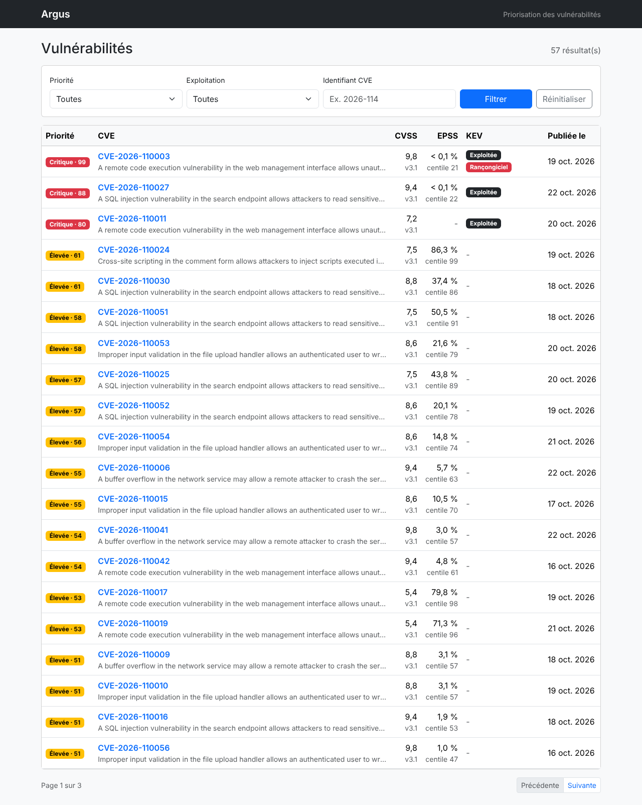
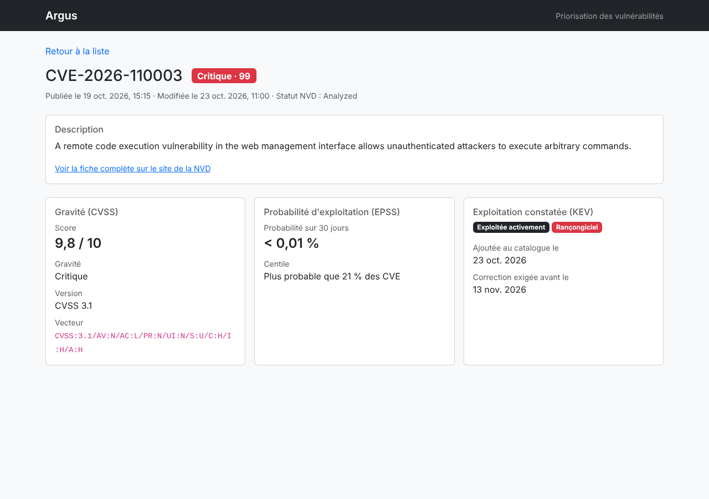
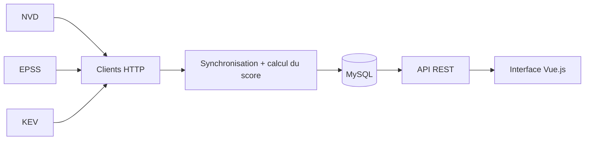

# Argus

**Priorisation des vulnérabilités par croisement de sources publiques.**

Argus récupère chaque jour les nouvelles vulnérabilités publiées (CVE) et les croise avec deux autres sources : la probabilité qu'elles soient exploitées et la liste des failles déjà attaquées. Il calcule ensuite un **score de priorité sur 100** pour répondre à une question simple : *quelle faille faut-il corriger en premier ?*

Projet réalisé dans le cadre du mastère Développement Full Stack de **Sup de Vinci**, par Chéridanh TSIELA et Jean ANANI.



---

## Sommaire

- [Le problème](#le-problème)
- [Notre valeur ajoutée](#notre-valeur-ajoutée)
- [Les sources de données](#les-sources-de-données)
- [Fonctionnalités](#fonctionnalités)
- [Architecture](#architecture)
- [Installation et lancement](#installation-et-lancement)
- [API REST](#api-rest)
- [Tests](#tests)
- [Choix techniques](#choix-techniques)
- [Limites et pistes d'amélioration](#limites-et-pistes-damélioration)

---

## Le problème

Plus de **500 nouvelles CVE** sont publiées chaque jour. Aucune équipe ne peut toutes les corriger, il faut donc choisir.

La méthode la plus répandue consiste à trier les failles par leur **score CVSS**, une note de gravité de 0 à 10. Mais le CVSS ne mesure qu'une chose : *la gravité des dégâts si la faille est exploitée*. Il ne dit pas si quelqu'un va réellement l'exploiter.

Conséquence : des équipes passent du temps sur des failles notées 9,8 que personne n'attaque, pendant qu'une faille notée 7,5, activement exploitée, attend son tour.

## Notre valeur ajoutée

Aucune des trois sources utilisées ne répond seule à la question « quoi corriger en premier ». **C'est leur croisement qui apporte la réponse.** Argus combine trois informations complémentaires :

| Source | Question à laquelle elle répond |
|---|---|
| **CVSS** (NVD) | Quelle est la gravité si la faille est exploitée ? |
| **EPSS** (FIRST) | Quelle est la probabilité qu'elle soit exploitée dans les 30 prochains jours ? |
| **KEV** (CISA) | Est-elle **déjà** exploitée par des attaquants ? |

### La formule

```text
score = 35 × (CVSS / 10)
      + 35 × percentile EPSS
      + 20 si la faille est dans le catalogue KEV
      + 10 si elle est utilisée par des rançongiciels
```

Le score sur 100 est traduit en quatre niveaux :

| Score | Niveau |
|---|---|
| 70 et plus | Critique |
| 45 à 69 | Élevée |
| 25 à 44 | Moyenne |
| Moins de 25 | Faible |

### Pourquoi ces choix

**Gravité et probabilité ont le même poids (35 points chacune).** Un risque se définit classiquement comme la combinaison d'un *impact* et d'une *probabilité*. Aucun des deux ne doit dominer l'autre.

**Le percentile EPSS plutôt que le score brut.** Le score EPSS brut est très déséquilibré : la grande majorité des CVE ont moins de 1 % de probabilité d'exploitation. Utilisé directement, il donnerait presque toujours 0 point. Le percentile indique la position d'une faille par rapport à toutes les autres (0,95 signifie « plus probable que 95 % des CVE ») et départage bien les failles.

**Une exploitation constatée l'emporte sur une prédiction.** Une faille présente dans le catalogue KEV reçoit un bonus de 20 points. De plus, son percentile EPSS est remplacé par 1 : EPSS *prédit* une exploitation, or celle-ci est déjà un fait. Cette règle a été ajoutée après analyse des données réelles (voir ci-dessous).

**Une donnée manquante prend une valeur neutre.** Une CVE récente n'a parfois pas encore de score CVSS ou EPSS. Elle reçoit alors une valeur neutre (CVSS 5, percentile 0,5). En sécurité, une information inconnue ne doit pas faire passer une faille pour sûre.

**Conséquence de ces règles :** sans exploitation constatée, le score maximum est de 70. Le niveau « Critique » est donc presque exclusivement réservé aux failles **réellement attaquées**.

### Exemples

| Cas | CVSS | Percentile EPSS | KEV | Score | Niveau |
|---|---|---|---|---|---|
| Log4Shell | 10 | 1,00 | Oui + rançongiciel | **100** | Critique |
| Faille activement exploitée | 7,8 | 0,95 | Oui | **82** | Critique |
| Grave et très probable | 7,5 | 0,98 | Non | **61** | Élevée |
| Grave mais improbable | 9,8 | 0,05 | Non | **36** | Moyenne |
| Moyenne et improbable | 5,3 | 0,20 | Non | **26** | Moyenne |

Les lignes 3 et 4 résument l'intérêt du projet. Une faille notée **9,8** par le CVSS, que tout le monde traiterait en urgence, descend en priorité moyenne car personne ne l'exploite. Une faille notée **7,5** mais très probablement exploitée passe devant elle.

### Une formule vérifiée sur des données réelles

La première version de la formule utilisait le percentile EPSS même pour les failles du catalogue KEV. Sur les données réelles, une CVE notée 9,4, **ajoutée au catalogue KEV le jour même**, n'obtenait que 69 points, soit le niveau « Élevée ».

La cause : EPSS met plusieurs jours à réagir quand une faille commence à être exploitée. Son percentile n'était encore que de 0,46. La formule a donc été corrigée pour qu'une exploitation constatée l'emporte sur la prédiction. Cette CVE obtient désormais 88 points (« Critique »). Ce cas réel est conservé dans les tests pour éviter toute régression.

---

## Les sources de données

| Source | Organisme | Contenu | Accès |
|---|---|---|---|
| [NVD CVE API 2.0](https://nvd.nist.gov/developers/vulnerabilities) | NIST (États-Unis) | Description, dates, scores CVSS de chaque CVE | Gratuit, clé d'API recommandée |
| [EPSS](https://www.first.org/epss/) | FIRST | Probabilité d'exploitation à 30 jours, mise à jour quotidienne | Libre, sans clé |
| [KEV](https://www.cisa.gov/known-exploited-vulnerabilities-catalog) | CISA (États-Unis) | Catalogue des failles exploitées activement, avec date limite de correction | Libre, sans clé |

---

## Fonctionnalités

**Synchronisation automatique**
- Premier chargement : les CVE publiées ces 7 derniers jours.
- Ensuite, toutes les 24 heures : uniquement les CVE nouvelles ou modifiées depuis la dernière synchronisation.
- Mise à jour quotidienne des scores EPSS et du marquage KEV, puis recalcul de tous les scores de priorité.

**API REST**
- Liste paginée, triée par priorité décroissante.
- Filtres cumulables : niveau de priorité, présence dans le catalogue KEV, recherche par identifiant.
- Fiche détaillée d'une CVE.
- Erreurs au format standard ProblemDetail (RFC 9457).

**Interface web**
- Tableau des vulnérabilités avec filtres et pagination.
- Fiche détaillée présentant chaque source séparément.
- Filtres conservés dans l'URL : un lien partagé redonne la même recherche.



---

## Architecture



### Stack technique

| Couche | Technologies |
|---|---|
| Back | Java 25, Spring Boot 4.1, Spring Data JPA, Hibernate 7 |
| Base de données | MySQL 8.4, migrations Flyway |
| Front | Vue.js 3, Vue Router, Bootstrap 5.3, Vite |
| Tests | JUnit 5, AssertJ, MockMvc, Testcontainers |
| Outils | Maven, Docker Compose |

### Organisation du code

```text
argus/
├── src/main/java/fr/supdevinci/argus/
│   ├── clients/           Clients HTTP des trois APIs externes
│   │   ├── epss/
│   │   ├── kev/
│   │   └── nvd/
│   ├── config/            Configuration des clients HTTP
│   ├── controllers/       API REST
│   ├── dtos/              Objets échangés avec le front
│   ├── entities/          Entité Vulnerability et niveaux de priorité
│   ├── exceptions/        Erreurs métier
│   ├── repositories/      Accès aux données et filtres de recherche
│   ├── schedulers/        Planification de la synchronisation
│   └── services/          Synchronisation, calcul du score, consultation
├── src/main/resources/
│   ├── application.yaml
│   └── db/migration/      Scripts Flyway (V1, V2...)
├── frontend/              Application Vue.js
├── compose.yaml           Base MySQL pour le développement
└── .env.example           Modèle des variables d'environnement
```

---

## Installation et lancement

### Prérequis

- **Java 25**
- **Docker Desktop**, pour la base MySQL et les tests
- **Node.js 20.19 ou plus récent**, pour le front
- Une **clé d'API NVD** gratuite, à demander sur [le site de la NVD](https://nvd.nist.gov/developers/request-an-api-key)

### 1. Configurer la clé d'API

```bash
cp .env.example .env
```

Puis renseigner la clé dans `.env` :

```properties
NVD_API_KEY=votre-cle
```

Le fichier `.env` est ignoré par Git : la clé n'est jamais versionnée.

### 2. Lancer le back

Docker Desktop doit être démarré. La base MySQL est lancée automatiquement par Spring Boot grâce à `compose.yaml`.

```bash
./mvnw spring-boot:run
```

L'API est disponible sur `http://localhost:8080`. La première synchronisation démarre 10 secondes après le lancement et prend environ 10 minutes. Sa progression est visible dans les logs :

```text
NVD : 500 CVE récupérées sur 4415.
...
Synchronisation terminée : 4415 CVE reçues de la NVD, 4027 scores EPSS mis à jour.
```

### 3. Lancer le front

```bash
cd frontend
npm install
npm run dev
```

L'interface est disponible sur `http://localhost:5173`.

### Variables d'environnement

| Variable | Obligatoire | Rôle |
|---|---|---|
| `NVD_API_KEY` | Oui | Clé d'API de la NVD |
| `ARGUS_SYNC_ENABLED` | Non | `false` pour désactiver la synchronisation, par exemple pendant le développement. Vaut `true` par défaut. |

---

## API REST

### Liste des vulnérabilités

```http
GET /api/vulnerabilities
```

| Paramètre | Exemple | Description |
|---|---|---|
| `page` | `0` | Numéro de page, à partir de 0 |
| `size` | `20` | Taille de la page, entre 1 et 100 (20 par défaut) |
| `level` | `CRITICAL` | Niveau : `CRITICAL`, `HIGH`, `MEDIUM` ou `LOW` |
| `knownExploited` | `true` | `true` pour les failles du catalogue KEV, `false` pour les autres |
| `search` | `2026-114` | Partie de l'identifiant CVE |

Tous les paramètres sont facultatifs et les filtres sont cumulables.

```http
GET /api/vulnerabilities?level=CRITICAL&knownExploited=true&size=10
```

### Détail d'une vulnérabilité

```http
GET /api/vulnerabilities/CVE-2026-114625
```

```json
{
  "cveId": "CVE-2026-114625",
  "description": "...",
  "publishedAt": "2026-10-22T14:15:00",
  "lastModifiedAt": "2026-10-23T09:00:00",
  "nvdStatus": "Analyzed",
  "priority": { "score": 88, "level": "CRITICAL" },
  "cvss": { "version": "3.1", "baseScore": 9.4, "severity": "CRITICAL", "vector": "CVSS:3.1/..." },
  "epss": { "score": 0.0123, "percentile": 0.45586 },
  "kev": { "dateAdded": "2026-10-23", "dueDate": "2026-11-13", "ransomwareUse": false }
}
```

Chaque source a son propre bloc. Un bloc vaut `null` quand la donnée n'existe pas, par exemple `"kev": null` pour une faille absente du catalogue.

### Erreurs

Les erreurs suivent le format ProblemDetail (RFC 9457) :

```json
{
  "type": "about:blank",
  "title": "Vulnérabilité introuvable",
  "status": 404,
  "detail": "La vulnérabilité CVE-1999-0001 est introuvable.",
  "instance": "/api/vulnerabilities/CVE-1999-0001"
}
```

---

## Tests

```bash
./mvnw test
```

Docker Desktop doit être démarré : les tests d'intégration utilisent **Testcontainers**, qui lance une base MySQL jetable dans la même version que celle du développement.

| Type | Ce qui est testé |
|---|---|
| Tests unitaires | Calcul du score, niveaux de priorité, choix du score CVSS |
| Clients HTTP | Conversion des réponses JSON, pagination NVD, envoi par lots EPSS, nouveaux essais, erreurs. Les APIs externes sont simulées : aucun appel réseau. |
| Persistance | Mapping de l'entité sur MySQL, schéma créé par Flyway |
| Synchronisation | Premier chargement, mise à jour incrémentale, absence d'écriture partielle en cas d'erreur |
| API REST | Filtres, pagination, tri, format JSON, erreurs 400 et 404 |

---

## Choix techniques

Quelques décisions prises pendant le développement, souvent à la suite d'un problème rencontré.

**Respect des quotas des APIs.** La NVD limite le nombre de requêtes. Argus respecte une pause de 6 secondes entre deux pages, comme le recommande la NVD. Les scores EPSS sont demandés par lots de 100 CVE au lieu d'une requête par CVE. Le catalogue KEV est un seul fichier, téléchargé une fois par jour.

**Synchronisation incrémentale.** Après le premier chargement, seules les CVE modifiées depuis la date de modification la plus récente en base sont récupérées. Aucune table supplémentaire n'est nécessaire pour mémoriser la dernière synchronisation.

**Résistance aux erreurs réseau.** Le serveur de la NVD coupait régulièrement les réponses en cours de transfert (erreur HTTP/2 `RST_STREAM`). Trois mesures ont réglé le problème :
- le passage en **HTTP/1.1**, plus stable avec ce serveur ;
- des **pages de 500 résultats** au lieu de 2 000 ;
- des **nouveaux essais** avec un délai qui double à chaque fois (*backoff exponentiel*), uniquement pour les erreurs temporaires. Une clé refusée (403) n'est pas réessayée.

**Pas d'appel réseau pendant une transaction.** Les données externes sont d'abord récupérées, puis enregistrées dans des transactions courtes. Une connexion à la base n'est jamais bloquée pendant un appel HTTP de plusieurs secondes.

**Schéma versionné avec Flyway.** Le schéma de la base est décrit dans des scripts SQL versionnés. Hibernate vérifie seulement que les entités correspondent au schéma (`ddl-auto: validate`). Chaque membre de l'équipe obtient la même base automatiquement.

**Pagination stable.** Plusieurs CVE ont souvent le même score. Le tri utilise donc l'identifiant CVE comme second critère. Sans cela, une même CVE pourrait apparaître sur deux pages différentes.

**Secrets hors du code.** La clé d'API est lue depuis le fichier `.env`, ignoré par Git, ou depuis une variable d'environnement.

---

## Limites et pistes d'amélioration

**Limites actuelles**
- Seules les CVE publiées depuis le premier lancement sont suivies. Une faille ancienne du catalogue KEV qui n'a pas été modifiée récemment par la NVD n'apparaît pas. Les ajouter demanderait environ 1 750 requêtes NVD supplémentaires au premier lancement.
- Une faille retirée du catalogue KEV, ce qui est rare, reste marquée comme exploitée.
- Le premier chargement est perdu s'il est interrompu : il recommence alors depuis le début.

**Pistes d'amélioration**
- Un tableau de bord avec des statistiques : nombre de failles par niveau, évolution dans le temps.
- Le filtrage par éditeur ou par produit, pour qu'une entreprise ne voie que les failles qui la concernent.
- Des alertes par e-mail quand une nouvelle faille critique apparaît.
- L'analyse d'un fichier de dépendances (`pom.xml`, `package.json`) pour lister les failles qui touchent un projet.
